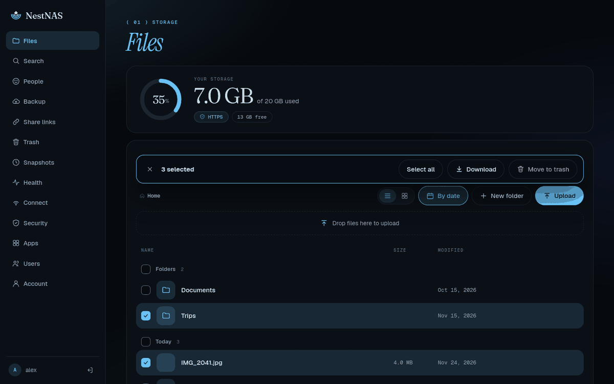
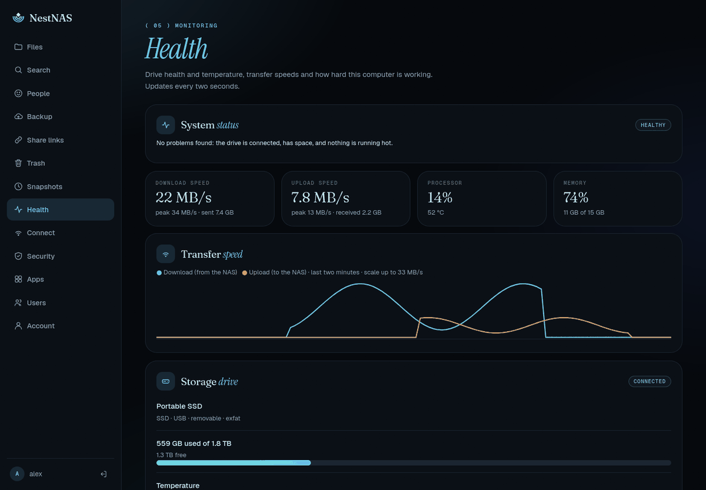
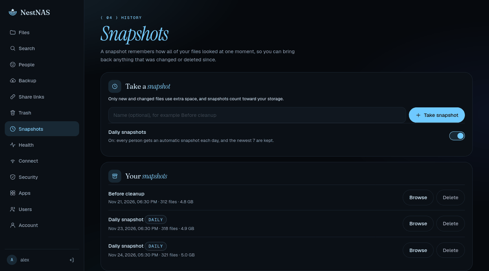

<p align="center"></p>

<h1 align="center">NestNAS</h1>

<p align="center"><b>Turn any laptop into your own private cloud.</b><br>
Lend some disk space and get a file manager, photo search, phone backup, an encrypted network drive and more.<br>
One program. Nothing else to install. No subscription.</p>

<p align="center">
  <a href="https://github.com/Saransh-Jainbu/nestnas/releases/latest"></a>
  <a href="https://github.com/Saransh-Jainbu/nestnas/actions/workflows/ci.yml"></a>
  <a href="LICENSE"></a>
  
  <a href="https://nestnas.vercel.app"></a>
</p>

<p align="center">
  <a href="#install">Install</a> ·
  <a href="#what-you-get">Features</a> ·
  <a href="#smart-search-and-people">Smart search</a> ·
  <a href="#setting-up-a-phone">Phone</a> ·
  <a href="#security-design">Security</a> ·
  <a href="#known-limitations">Limitations</a> ·
  <a href="#roadmap">Roadmap</a>
</p>

<p align="center"><br>
<sub>Screenshots show the real dashboard with sample data.</sub></p>

> **Status: early (pre-1.0).** It works end to end and is well tested, but it has had no independent security audit, and several parts have only been tried on one Linux laptop (see [Known limitations](#known-limitations)). Don't rely on it as the only copy of data you can't replace.

## Why NestNAS

- **Easy.** A two-minute setup page asks four questions. Everything is done from the web page, and there are no config files to edit.
- **Yours.** Files stay on your laptop or on an external drive. The core is a single Go program that uses only the standard library: no database, no cloud, no dependencies to audit.
- **Private.** HTTPS with its own certificate authority, optional AES-256 encryption on the drive, and AI features (photo search, faces) that run on your computer and never send anything out.
- **Safe to unplug.** Pull the external drive out and plug it back in whenever you like. NestNAS never falls back to your laptop's disk and carries on by itself.

## What you get

### Your files

| | |
|---|---|
| **Web file manager** | Drag-and-drop upload with progress, resumable download, folders, rename, zip a whole folder |
| **Select several** | Tick files (shift-click for a range, a heading's box for a whole group), then download them as one zip or move them to the trash |
| **Group by date** | Like Google Drive and Photos: Today, Yesterday, Previous 7 days, then by month |
| **Preview and gallery** | Photos, videos, audio, PDFs and text open inside NestNAS, with a full-screen viewer, swipe or arrow keys, and video seeking |
| **Search** | By file name and by words inside text files; with smart photo search, by what a photo shows |
| **People** | Optional face recognition: photos grouped by person, named by you. A photo with two people appears under both |
| **Share links** | A public download link per file, with expiry and revoke |
| **Users and quotas** | Each person gets a private folder and their own space limit. No partitioning, no root |

### Keeping it safe

| | |
|---|---|
| **Encryption at rest** | One switch in Security. File contents are AES-256-GCM encrypted on the drive and open normally in the app. Switch it off and everything is decrypted again |
| **Encryption in transit** | HTTPS (TLS 1.3 only) with a private certificate authority that is limited to private network addresses |
| **Trash** | Deleted files can be restored for 30 days |
| **File versions** | Replacing a file keeps the old copy: the last 10 versions, up to 90 days, with download and restore |
| **Snapshots** | A point in time for all your files. Browse, download, and restore a file, a folder or everything, without deleting anything. Optional daily snapshots |
| **Health monitor** | Upload and download speed, drive usage, activity and temperature, processor, memory, battery, and warnings in plain language |

<table>
  <tr>
    <td width="50%"></td>
    <td width="50%"></td>
  </tr>
  <tr>
    <td align="center"><sub>Health: speeds, drive, temperature</sub></td>
    <td align="center"><sub>Snapshots: go back to any day</sub></td>
  </tr>
</table>

### Your devices

| | |
|---|---|
| **Phone and computer backup** | The Backup tab copies photos, videos or a folder over Wi-Fi. Safe to repeat: it skips what's already there, never overwrites or deletes, keeps each photo's date, and retries bad Wi-Fi |
| **Network drive** | Built-in WebDAV: mount your NAS in Finder, Windows Explorer or a Linux file manager with your NestNAS login |
| **Mobile-friendly** | Bottom tab bar, tap-friendly lists, installable on a phone's Home Screen |
| **Desktop app** | The same dashboard in its own window (Linux package) |
| **External drives** | Choose a USB or external drive as storage; [unplug and replug freely](#using-an-external-drive) |
| **Remote access** | Guided Tailscale setup, no port forwarding |
| **App hosting** | One-click Jellyfin, Vaultwarden, Syncthing and Uptime Kuma through Docker |
| **Static websites** | Put files in a `site` folder and they are served at `/sites/<username>/` |

## Install

**One line** (checks a published SHA-256 checksum before installing):

```bash
curl -fsSL https://raw.githubusercontent.com/Saransh-Jainbu/nestnas/main/install.sh | sh      # Linux / macOS
```
```powershell
irm https://raw.githubusercontent.com/Saransh-Jainbu/nestnas/main/install.ps1 | iex           # Windows
```

**Or download** the single-file program for your system from the [latest release](https://github.com/Saransh-Jainbu/nestnas/releases/latest), then run `nestnas service install`. Linux builds are fully static, so they run on any distribution.

**Or build it** (Go 1.18 or newer):

```bash
git clone https://github.com/Saransh-Jainbu/nestnas.git
cd nestnas
make build
./nestnas service install      # start now and on every login or boot
```

Then open <http://localhost:8080>. The setup page asks for an admin login, how many GB to lend, where files live, and whether to encrypt them.

### Desktop app (Linux)

Download `nestnas_<version>_amd64.deb` from the release and install it:

```bash
sudo apt install ./nestnas_*_amd64.deb
```

It shows the dashboard in a native window and attaches to the background service if one is running. The package needs `libwebkit2gtk-4.0`, which Ubuntu 22.04 and Debian 12 have; on newer systems use the plain program and open the dashboard in a browser. To build it yourself: `sudo apt install libgtk-3-dev libwebkit2gtk-4.0-dev && make desktop-deb`. It lives in its own Go module (`desktop/`, Wails v2.6) so the core stays dependency-free.

### Autostart

```bash
nestnas service install      # run in the background now and on every boot or login
nestnas service status
nestnas service uninstall    # removes autostart only; files and settings are untouched
```

It runs as your normal user, no root needed: a systemd user unit (Linux), a LaunchAgent (macOS) or Task Scheduler (Windows). **Laptop tip:** closing the lid suspends the machine and takes the NAS offline; `service install` prints the setting that prevents that.

## Ports

| Port | Who can reach it | What it serves |
|---|---|---|
| `8080` | **This computer only** (`127.0.0.1`) | The dashboard over plain HTTP, which never touches the network |
| `8443` | Other devices on your network | The dashboard, WebDAV and share links over **HTTPS (TLS 1.3)** |
| `8081` | Other devices on your network | **Device setup page: only the public certificate** and an Apple profile, so a new phone can start trusting your NAS |

## Setting up a phone

1. On the phone (same Wi-Fi), open `http://<laptop-ip>:8081` in **Safari** and install the certificate profile it offers. On iPhone and iPad, then turn it on under *Settings, General, About, Certificate Trust Settings*. The **Security** tab has steps for Android, Windows, Mac and Linux too, and the certificate fingerprint to compare.
2. Open `https://<laptop-ip>:8443`, log in, then Share, **Add to Home Screen** to use it like an app.
3. Use the **Backup** tab to copy your photos and videos to the NAS.

The certificate install is a one-time step per device. It exists because NestNAS uses its own certificate authority instead of a public one; it keeps your password and photos encrypted on the Wi-Fi and proves the phone is talking to your laptop.

Apple's **Files app does not support WebDAV** (it only speaks `smb://`), so on an iPhone use the web app, or a WebDAV app such as Documents by Readdle with `https://<ip>:8443/dav/`.

## Smart search and people

Optional, and off until an admin switches it on in the **Search** tab.

- **Smart photo search** finds photos by what they show: "beach at sunset", "birthday cake", "dog".
- **People** finds faces, groups them by person, and lets you name them. Searching a name finds that person's photos, a photo with two people appears under both, and the viewer shows who is in it. Use **Merge** (give two groups the same name) and **This is not them** to correct mistakes.

Everything runs inside NestNAS, in pure Go, with no extra software. Photos are analysed in the background and the results are stored in your own folder (`.search/`), encrypted when you use encryption. The only network use is a one-time model download, checked against pinned SHA-256 checksums:

| Feature | Model | Size | Licence |
|---|---|---|---|
| Photo search | TinyCLIP (Standard, or a smaller one) from Hugging Face | 337 MB / 94 MB | MIT |
| Faces: finding | YuNet from the OpenCV model zoo | 0.2 MB | MIT |
| Faces: telling people apart | SFace from the OpenCV model zoo | 39 MB | Apache-2.0 |

The first pass over a library is slow (roughly one photo per second, using a share of your processor); after that only new photos are processed. Results are good, not perfect: photo search is weaker than the big cloud models, and face grouping can split one person in two or confuse look-alikes, children and profile views. Face data is biometric: it stays on your drive, and turning face recognition off deletes it. The numeric code was checked against independent references (numpy for the search model, onnxruntime and OpenCV for the face models).

## Security design

- **Passwords:** PBKDF2-HMAC-SHA256 (200k iterations), a random salt per user, constant-time compare. Login attempts are rate-limited per IP.
- **Sessions:** random 256-bit tokens in `HttpOnly; SameSite=Strict` cookies (`Secure` over HTTPS), with a CSRF origin check on every write.
- **Files:** every path is resolved inside the user's own folder, **including through symlinks** (`internal/fsx`). Users only see their own folder.
- **In transit:** TLS 1.3 only (`internal/tlsutil`). NestNAS creates a private certificate authority that is **name-constrained to private network addresses**, so even if its key leaked it couldn't impersonate a public website. Certificates are re-issued automatically when the laptop's IP changes.
- **At rest** (`internal/vault`): AES-256-GCM in 64 KiB authenticated chunks with a separate key per file; tampering, truncation and reordering are detected. The master key is wrapped by your passphrase (memory-hard **scrypt**, 64 MiB per guess) and by a one-time **recovery key**. After a restart an admin unlocks the storage, or opts in to auto-unlock, which keeps the key on the laptop's own disk. **File and folder names, sizes and dates are not hidden; contents are.**
- **User websites** are served with `Content-Security-Policy: sandbox` so they can't reach the admin API.
- Don't port-forward NestNAS to the internet; use Tailscale for access away from home.

The cryptographic primitives that matter (PBKDF2, HKDF, scrypt) are checked against the official RFC test vectors and cross-checked with OpenSSL. See [SECURITY.md](SECURITY.md) for the threat model and how to report a vulnerability.

### Using an external drive

Pick it in the setup page: **Choose folder…** lists your drives with free space and warns about limits (FAT32 can't hold files over 4 GB; NTFS and exFAT don't keep Linux permissions).

**Unplug and replug whenever you like.** NestNAS stamps its storage folder with a hidden identity file and remembers where it sits on the drive:

- **Drive removed:** NestNAS pauses and shows a warning, and you can still sign in to see what's wrong. It never falls back to your laptop's own disk, and it refuses any *other* drive that appears at the same place.
- **Drive plugged back in:** it resumes by itself within seconds, even if your computer mounts it somewhere different this time.
- A file mid-upload when the drive is pulled fails and must be re-sent. Docker apps keep data on the drive too, so restart them after replugging.

### Network drive (WebDAV) notes

- Address: `https://<ip>:8443/dav/` with your NestNAS username and password. Install the NestNAS certificate on the device first.
- Tested against GNOME's real WebDAV client (mount, list, create, copy in and out, read back). macOS Finder and Windows are expected to work but **haven't been tested on real devices yet**.
- Deleting over WebDAV goes to the trash. Locks are accepted but not enforced (enough for Finder to write).

## Known limitations

- **Encryption:** names, sizes and dates stay visible. It protects a stolen laptop or drive while locked, and your traffic on the network; it does not protect against malware on the unlocked NAS or someone who knows your passphrase. If you lose both the passphrase and the recovery key, your files are unrecoverable by design. The file format is NestNAS's own and **has not been independently audited**.
- **Versions and snapshots** are not a backup of the drive: they live on the same drive and count toward each person's allowance. On exFAT/FAT drives a snapshot stores real copies of changed files; on ext4, NTFS and APFS it shares disk blocks with the live files. A renamed or moved file starts a new version history.
- **Smart search and people** read JPEG, PNG and GIF photos (not HEIC or WebP yet) up to about 80 megapixels. Small faces in large group photos can be missed. Switching the search model re-indexes everything.
- **Health monitor** reads the system's own counters (Linux `/proc` and `/sys`), so macOS and Windows show less. Most USB drives don't report their temperature or SMART data to the computer; install `smartmontools` and let NestNAS run `smartctl` on the drive (it usually needs root or a sudo rule) to see them. Without it the monitor says so instead of guessing.
- **Phones:** iOS Safari can't upload in the background, so phone backup needs the page open with the screen on. Truly automatic backup would need a native app.
- **Certificates:** each new device needs a one-time certificate install; there is no public-CA (Let's Encrypt or Tailscale) option yet.
- **Platforms:** developed and tested on Ubuntu Linux. Windows and macOS builds compile and the logic is shared, but they haven't been run for real. Free-disk checks aren't implemented on Windows.
- **Not yet verified on real hardware:** real Docker app installs, Tailscale setup, service registration on other operating systems, and iPhone, Mac and Windows clients.
- Sessions are in memory (a restart means logging in again), and there is no "forgot password" flow yet.

## Project layout

```
main.go                  CLI: serve | service | version
pkg/app                  public, stdlib-only API to embed the server (used by desktop/)
internal/config          users, quotas, share links (JSON file, atomic writes)
internal/auth            password hashing, PBKDF2 / HKDF / scrypt
internal/vault           at-rest file encryption and key management
internal/vision          photo search (CLIP) and face models, in pure Go
internal/tlsutil         private certificate authority and TLS 1.3 setup
internal/fsx             symlink-safe path jail, usage accounting
internal/server          HTTP API, WebDAV, previews, backup, versions, snapshots, search, people, health
internal/service         autostart: systemd / launchd / Task Scheduler
internal/web             the embedded single-file dashboard
desktop/                 native window (separate Go module, Wails)
site/                    the landing page (nestnas.vercel.app)
install.sh, install.ps1  one-line installers (checksum-verified)
scripts/smoke.sh         end-to-end tests:  make smoke
.github/workflows        CI, and tagged releases (git tag v0.x.0)
```

## Roadmap

1. A "forgot password" reset command
2. Public-CA HTTPS through Tailscale certificates (no certificate install on devices)
3. Automatic phone backup (iOS Shortcuts or a native app)
4. Folder sharing between users, and HEIC and WebP photos in search
5. Backups of the NAS itself to a second disk or cloud (S3, R2), and `nestnas.local` through mDNS
6. More native packages (`.msi`, Homebrew) and auto-update

## Contributing

See [CONTRIBUTING.md](CONTRIBUTING.md). Security issues: [SECURITY.md](SECURITY.md). Working with AI coding agents: [AGENTS.md](AGENTS.md).

`make test` and `make smoke` must pass (smoke runs twice: encryption off and on). Keep it beginner-friendly: every feature should work from the web UI with zero config files.

## Licence

MIT, see [LICENSE](LICENSE). The optional AI models keep their own licences (MIT and Apache-2.0), listed above.
